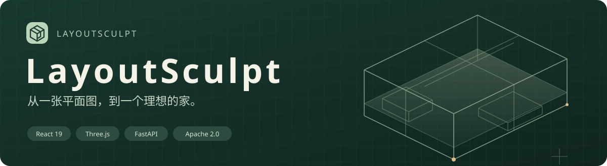
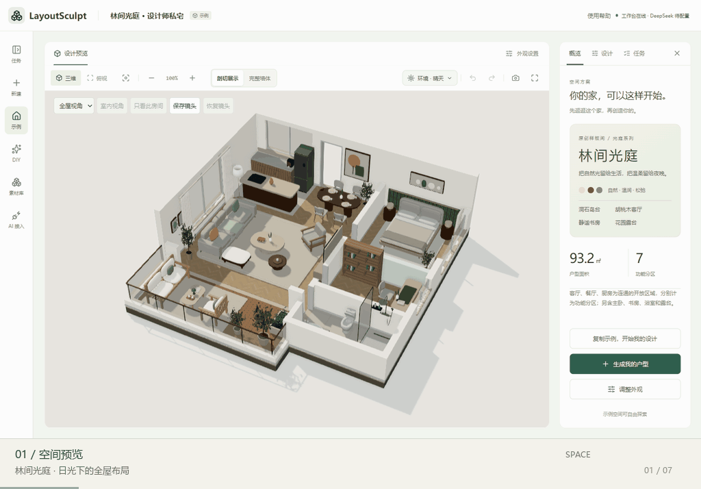
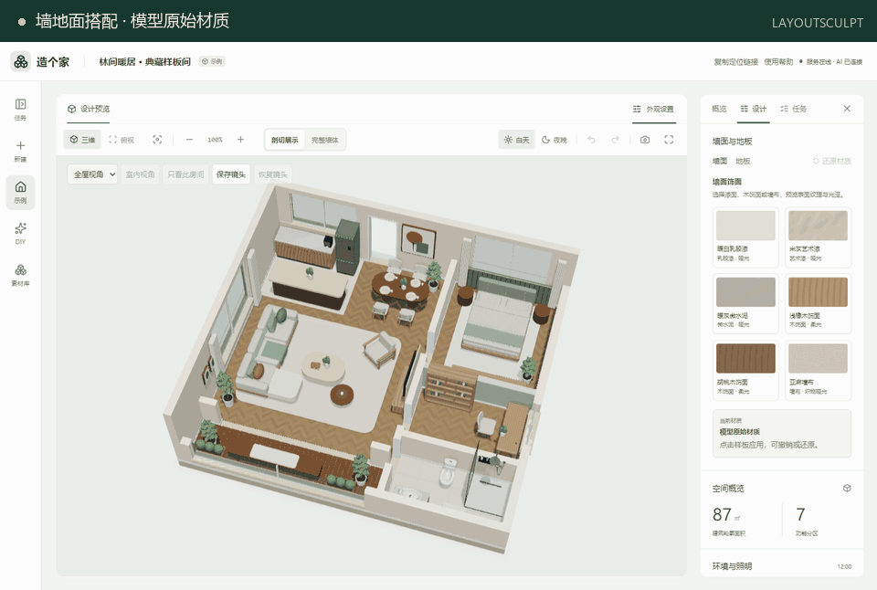
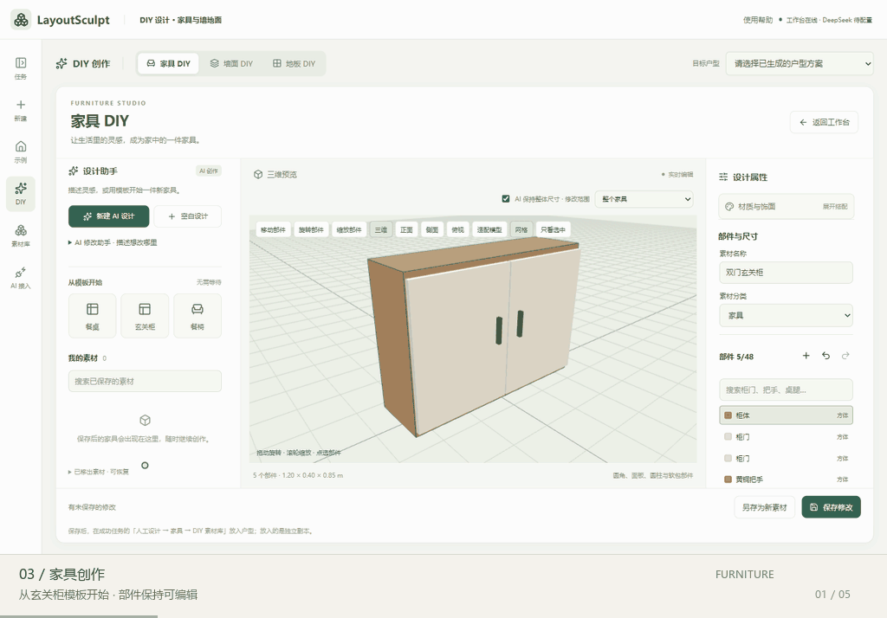
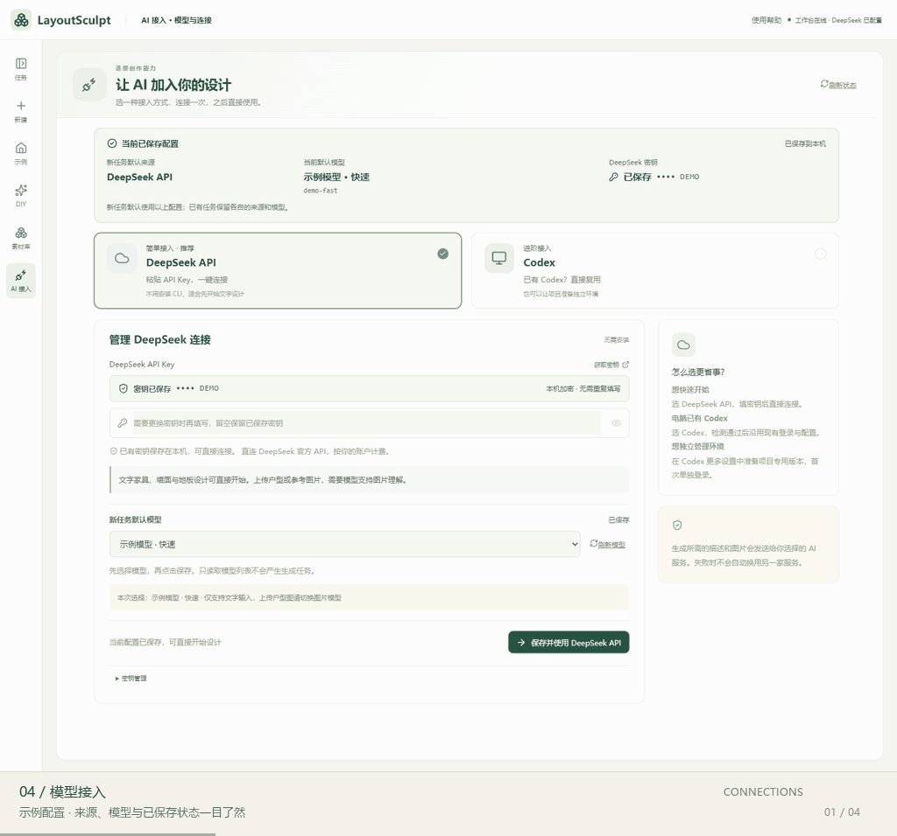

<p align="center">
  
</p>

<p align="center">
  <strong>从一张户型图开始，也从一个家具灵感开始。</strong><br />
  一个可识别、可编辑、可创作的开源 AI 空间设计工作台。
</p>

<p align="center">
  <a href="https://hub.xerj.org/contributors/Li-Rui-Zhe"></a>
</p>

<p align="center">
  <a href="#preview">看演示</a> · <a href="#quickstart">开始使用</a> · <a href="docs/README.md">文档中心</a> · <a href="CONTRIBUTING.md">参与改进</a> · <a href="SECURITY.md">反馈问题</a>
</p>

---

**LayoutSculpt** 把户型识别、三维编辑、材质搭配和家具创作放进同一个工作台。你可以上传户型，也可以复制示例开始设计；调整好的空间与素材，可保存为独立版本并导出 GLB。

**本机工作台** · **Codex / DeepSeek API 接入** · **普通建模无需 Blender**

<a id="preview"></a><a id="workspace"></a>

## 01 / 先看见，一个完整的家

<p align="center">
  <a href="docs/images/showcase.gif">
    <picture>
      <source media="(prefers-reduced-motion: reduce)" srcset="docs/images/workbench.webp" />
      
    </picture>
  </a>
</p>

<p align="center"><sub>林间光庭 · 93.2㎡ · 七个功能分区<br />旋转、切换光照、走近花园露台，再回到俯视布局。</sub></p>

这是一套随项目分发的**原创样板间**。演示来自当前版本的真实页面，上传户型的识别结果仍需要对照原图校对。

| 理解空间 | 亲手设计 | 留下成果 |
| :--- | :--- | :--- |
| 户型识别、原图叠加、结构核对 | 平面 / 三维编辑、墙体、门窗与灯具 | GLB、效果图与成果包 |
| 三维 / 俯视、剖切、晴天 / 日落 / 夜晚 | 墙地面搭配、家具 DIY、素材复用 | 草稿、版本与阶段恢复 |

<a id="materials"></a>

## 02 / 同一个空间，不同的搭配

<p align="center">
  <a href="docs/images/materials.gif">
    <picture>
      <source media="(prefers-reduced-motion: reduce)" srcset="docs/images/materials-poster.webp" />
      
    </picture>
  </a>
</p>

<p align="center"><sub>从墙面到地板 · 从全屋到单独房间<br />点击样板查看效果，比较材质，也可以随时还原。</sub></p>

墙面支持独立饰面，地板可以按房间铺设。人工设计中保存为新版本后，导出的 GLB 会保留对应墙地面材质。素材库还提供 **17 种建筑构件与 6 款灯具**。

[墙地面创作 →](docs/surface-creation.md)　[建筑构件与阳台围护 →](docs/balcony-boundaries.md)

<a id="diy"></a>

## 03 / 家具，也可以自己造

<p align="center">
  <a href="docs/images/diy.gif">
    <picture>
      <source media="(prefers-reduced-motion: reduce)" srcset="docs/images/diy-poster.webp" />
      
    </picture>
  </a>
</p>

<p align="center"><sub>模板起步 · 调整饰面 · 旋转检查 · 撤销修改<br />以上为真实的手动模板编辑过程，不调用 AI。</sub></p>

从模板或空白设计开始，也可以描述想法，让 AI 返回可编辑的家具部件。尺寸、位置、形状与材质都能继续调整；保存的素材可以放进不同户型复用。

**83 款内置家具 / 45 个品类** · **家具、墙面、地板独立创作** · **GLB 导入与导出**

[家具与素材使用 →](docs/design-workflows.md)　[家具选型与单件换款 →](docs/furniture-selection-and-replacement.md)

<a id="connections"></a>

## 04 / 选好模型，再开始创作

<p align="center">
  <a href="docs/images/ai-connections.gif">
    <picture>
      <source media="(prefers-reduced-motion: reduce)" srcset="docs/images/ai-connections-poster.webp" />
      
    </picture>
  </a>
</p>

<p align="center"><sub>查看已保存来源、模型与密钥状态，明确区分未保存的选择。<br />接入页使用标注为「示例模型」的演示配置，不使用真实凭据、不发起 AI 生成。</sub></p>

选择 **DeepSeek 官方 API**，或复用本机 Codex、准备项目独立环境。户型与参考图识别需要所选模型实际支持图片理解；文字模型可用于无参考图的家具、墙面和地板创作。

[AI 接入与模型选择 →](docs/ai-connections.md)

<a id="workflow"></a>

## 把你的户型带进来

| 01 · 上传 | 02 · 看初稿 | 03 · 校对与编辑 | 04 · 保存与复用 |
| :--- | :--- | :--- | :--- |
| PNG / JPEG / WebP，最大 20 MB | 默认先展示真实建筑三维初稿，再补齐家具 | 对照原图，调整结构、布局与材质 | 保存独立版本，导出模型与成果包 |

新建页默认精细识别与 AI 复核。你也可以选择「先看平面图，确认后再生成 3D」，在继续建模前先核对结构。未人工核对的初稿会明确标注；缺少原图尺寸时只能估算。

[精细识别与原图对照 →](docs/source-evidence-recognition.md)　[完整生成流程 →](docs/ai-pipeline-design.md)

---

<a id="quickstart"></a>

## 开始使用

需要 **Node.js 22+、pnpm、Python 3.11+** 和支持 WebGL 的浏览器。AI 来源在工作台中配置。

<details open>
<summary><strong>Windows / PowerShell</strong></summary>

```powershell
git clone git@github.com:Li-Rui-Zhe/LayoutSculpt.git D:\LayoutSculpt
cd D:\LayoutSculpt
pnpm install --frozen-lockfile
python -m venv .venv
.\.venv\Scripts\python.exe -m pip install -r backend/requirements-dev.txt
pnpm build
pnpm start
```

</details>

<details>
<summary><strong>macOS / Terminal</strong></summary>

```sh
git clone git@github.com:Li-Rui-Zhe/LayoutSculpt.git
cd LayoutSculpt
pnpm install --frozen-lockfile
python3 -m venv .venv
.venv/bin/python -m pip install -r backend/requirements-dev.txt
pnpm build
pnpm start
```

macOS 需要重新创建 `.venv`；桌面使用体验仍待实机验收。

</details>

打开 **[本机工作台](http://127.0.0.1:8000/)**。完成安装和构建后，Windows 也可双击根目录的 **启动工作台.cmd**。

开发模式运行 `pnpm dev:all`：前端使用 `5173`，API 使用 `8000`。端口、CLI、代理、配置与数据备份见 [完整上手指南](docs/getting-started.md)。

<a id="development"></a>

## 继续探索

| 想做什么 | 从这里开始 |
| :--- | :--- |
| 配置环境、连接 AI、处理启动问题 | [开始使用](docs/getting-started.md) / [AI 接入](docs/ai-connections.md) |
| 调整空间、家具、门窗和材质 | [设计工作流](docs/design-workflows.md) / [三维直接编辑](docs/live-3d-editing.md) |
| 了解实现、校验与恢复机制 | [流程设计](docs/ai-pipeline-design.md) / [测试说明](docs/testing.md) |
| 参与开发、维护资产和文档 | [贡献说明](CONTRIBUTING.md) / [源码与资产](docs/repository.md) |

完整目录见 **[文档中心](docs/README.md)**。项目基于 React、Three.js、FastAPI、LangChain、LangGraph 与 SQLite。

## 反馈与许可

欢迎通过 [Issues](https://github.com/Li-Rui-Zhe/LayoutSculpt/issues) 提问或提出建议；需要私下沟通的安全问题，可使用 [可选私密入口](SECURITY.md)。

任务数据保存在本机；AI 推理会调用所配置的服务，图片和必要上下文可能发送给该服务。分享截图与报告前，请隐去密钥、登录信息和私人数据。

项目使用 [Apache License 2.0](LICENSE)。

<p align="center"><sub>LayoutSculpt · 从户型识别，到空间设计与素材创作。</sub></p>
