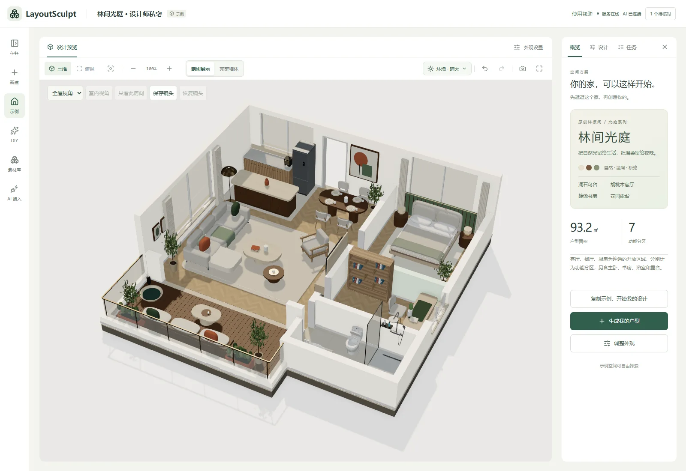

<p align="center">
  
</p>

<p align="center">
  <strong>从户型识别，到空间设计与素材创作。</strong><br>
  Codex / API 接入 · 户型识别 · 三维编辑 · 建筑构件 · 材质与家具创作
</p>

<p align="center">
  <a href="#preview">空间演示</a> ·
  <a href="#materials">材质搭配</a> ·
  <a href="#diy">家具 DIY</a> ·
  <a href="#quickstart">快速开始</a> ·
  <a href="docs/design-workflows.md">详细用法</a> ·
  <a href="SECURITY.md">安全政策</a>
</p>

---

**LayoutSculpt** 是支持 Codex 与 API 接入的开源 AI 空间设计工作台，涵盖户型识别、交互式 3D 编辑、建筑构件与灯具、家具与墙地面 DIY、素材管理及 GLB 导出。

项目采用 React、Three.js、FastAPI、LangChain、LangGraph 和 SQLite。你可以上传户型开始设计，也可以直接体验示例、编辑已有空间，或制作与复用家具、墙面和地板素材。当前直接 API 接入为 **DeepSeek 官方接口**，Codex 支持复用本机环境或使用项目独立环境。

**本地单人使用** · 浏览器连接本机服务 · 任务保存在本机 · 普通生成无需安装 Blender

在「AI 接入」选择模型来源：本机 Codex 可复用现有 CLI，也可由项目独立管理；DeepSeek API 通过密钥连接。户型及参考图识别需要服务商实际提供支持图片理解的模型，文字模型可用于无参考图的家具和材质设计。来源选择与具体能力见 [AI 接入说明](docs/ai-connections.md)。

<a id="preview"></a>

## 从平面，到空间

<p align="center">
  <a href="docs/images/showcase.gif"></a>
</p>

<p align="center"><sub>01 / 林间光庭 · 走进你的第一个空间<br>93.2㎡、七个功能分区，柚木花园会客厅、洞石岛台与温暖夜景。画面来自项目实际 Three.js 渲染。</sub></p>

> 演示为随项目提供的原创「林间光庭」，不是上传户型的一键识别结果。用户任务默认先展示通过几何检查的三维初稿，并标记尚未人工核对；也可在新建页勾选「先看平面图，确认后再生成 3D」，先检查、调整识别结果再继续。还原度仍取决于原图质量与人工校对。

| 看清空间 | 亲手调整 | 保留成果 |
| :--- | :--- | :--- |
| 三维 / 俯视 / 墙体剖切 | 墙体 / 门窗 / 家具 / 灯位 | GLB 模型 / 结构数据 |
| 白天 / 夜晚 / 材质预览 | 撤销 / 草稿 / 独立版本 | 效果图 / 一致性报告 |

<details>
<summary><strong>查看完整工作台截图</strong></summary>



</details>

<a id="materials"></a>

## 同一个家，不同的氛围

<p align="center">
  <a href="docs/images/materials.gif"></a>
</p>

<p align="center"><sub>02 / 材质搭配 · 墙面独立饰面，地板按房间铺设<br>使用当前「林间光庭」示例录制；点击样板直接查看结果。</sub></p>

- 墙面与地板都能调整；房间可单独铺设，人工设计支持逐墙独立饰面。
- 预览可撤销、重做和还原；将墙地面保存为新的设计版本后，GLB 保留对应材质。
- 素材库分为三维模型、装修材质、建筑构件和灯具，支持分类搜索；墙面材质可在立体墙段上旋转查看。灯具提供六款真实模型，可在平面或三维中选择落点添加。

### 建筑构件，也能在素材库里选

「素材库 → 建筑构件」提供 **5 类、17 种常用住宅构件**：

| 分类 | 构件 |
| --- | --- |
| 墙体 | 普通实墙、半高隔墙、落地玻璃隔断 |
| 门 | 单开平开门、双开平开门、双扇玻璃移门、卫生间窄门 |
| 窗 | 固定窗、双扇平开窗、双扇推拉窗、落地固定窗、卫生间磨砂窗 |
| 通道 | 标准无门扇门洞、宽开放通道 |
| 阳台围护 | 实体低栏板、玻璃栏板、阳台封窗玻璃 |

选中构件可旋转预览并调整尺寸；墙体围护按原墙段长度适配，门窗和通道会创建真实开口，也可替换已有开口。应用到人工设计草稿后可撤销，保存生成后更新正式模型。安装会检查墙高、重叠、边界及锁定状态。完整入口和阳台高度说明见 [建筑构件与阳台围护](docs/balcony-boundaries.md)。

<a id="diy"></a>

## 家具，也可以自己造

<p align="center">
  <a href="docs/images/diy.gif"></a>
</p>

<p align="center"><sub>03 / 家具 DIY · 模板起步，换材质，换视角，随时撤销<br>演示为手动模板编辑，不调用 AI，也不展示加速后的 AI 生成等待过程。</sub></p>

描述你想要的家具，让 AI 返回可编辑部件；也可以从模板或空白设计开始。调整部件的形状、尺寸、位置与材质，保存到本地素材库，再放入不同户型中复用。

**83 款内置家具 · 45 个品类** · **部件编辑** · **GLB 导出与导入** · **素材独立副本**

详细说明、淋浴形式切换、房间地板、素材放置与共享边界见 [设计工作流](docs/design-workflows.md)。

## 把你的户型带进来

1. **上传** — PNG、JPEG 或 WebP 户型图，最大 20 MB。
2. **查看空间** — 识别与校验后先展示真实三维建筑初稿，标明尚未人工核对，后台继续布置家具。
3. **调整设计** — 完成后进入人工设计，修改墙体、房间、门窗、家具与材质。
4. **保存成果** — 保留原方案，将修改保存为独立版本，再导出模型和成果包。

默认精细家具和 AI 复核；模型、推理强度与家具模式收在高级设置。「先看平面图，确认后再生成 3D」始终显示在生成按钮附近，可选择先对照原图检查和调整。复核未完成时也会停在平面图页面。失败后优先点击“继续生成”；更换模型另建版本，已有设计与草稿保留。

识别方式可选快速或精细，新建页默认精细：先定位原图轮廓和墙线，再结合整图与最多三张局部图读取房间、门窗，由程序统一换算尺寸。开启 AI 复核时先独立读原图，再比较候选；发现结构分歧会停在平面图页，可切换原图叠加并调节线条透明度。精细模式增加读图步骤，耗时依图像与模型而定；旧任务保持原流程。详见 [精细识别与原图对照](docs/source-evidence-recognition.md)。

任务保留历史版本、阶段缓存与检查点。家具规划不能改写已确认的建筑结构；服务重启后按有效检查点恢复处理。技术方案见 [AI 流程设计](docs/ai-pipeline-design.md)。

---

<a id="quickstart"></a>

## 环境要求

| 依赖 | 说明 |
| --- | --- |
| Node.js | 22+ |
| pnpm | 前端依赖和项目命令，使用 `pnpm-lock.yaml` |
| Python | 3.11+；当前固定依赖在 Windows、Python 3.13.5 下验证 |
| AI 来源 | 本机已登录的 Codex CLI，或在「AI 接入」中连接 DeepSeek API；户型识别需支持图片理解的模型 |
| 验收浏览器 | Windows 默认 Edge，Mac 默认 Playwright Chromium；日常使用支持 WebGL 的浏览器 |

Codex 可复用本机环境，也可由项目准备独立 CLI、配置与登录；独立模式不复制原登录凭据、不修改全局模型配置。Blender 仅用于可选的离线家具源工程制作。

## 首次安装与启动

以下命令在 Windows PowerShell 中运行，项目目录可放在 D 盘：

```powershell
git clone git@github.com:Li-Rui-Zhe/LayoutSculpt.git D:\LayoutSculpt
cd D:\LayoutSculpt
pnpm install --frozen-lockfile
python -m venv .venv
.\.venv\Scripts\python.exe -m pip install -r backend/requirements-dev.txt
pnpm build
pnpm start
```

打开 **http://127.0.0.1:8000/**。API 文档：http://127.0.0.1:8000/docs。

安装并构建后，Windows 日常使用只需双击项目根目录的 **启动工作台.cmd**：自动检查、启动并打开页面；当前项目已经运行时直接复用。成功后启动窗口自动关闭，后台继续运行。遇到问题才显示简短原因、重试与日志入口。也可使用 `pnpm launch` 打开启动窗口（需要 Python 的 Tk 组件）。

`pnpm start` 使用单个 FastAPI 进程同时提供构建页面和 API，只监听本机，并自动打开浏览器；加 `--no-browser` 可关闭自动打开。修改前端后需重新 `pnpm build`。终端 Ctrl+C 只关闭该次命令新启动的服务，不关闭已经运行并被复用的服务。

同为 Windows、Python 3.13.5 的环境，可用 `backend/requirements.lock.txt` 替代范围依赖文件安装，复现已验证的 Python 包版本。其他环境使用 `requirements-dev.txt` 并运行测试。

macOS 安装时，请在项目目录重新创建 Python 环境，不要复制 Windows 的 `.venv`：

```sh
pnpm install --frozen-lockfile
python3 -m venv .venv
.venv/bin/python -m pip install -r backend/requirements-dev.txt
pnpm build
pnpm start
```

启动脚本优先使用项目 `.venv`，找不到时在 macOS 优先查找 `python3`。本机 Codex 优先读取 `CODEX_CMD` / PATH，并补充常见 Homebrew 安装路径；需要时在 `.env` 中指定完整路径。Windows 已完成本机验收；CI 已配置 Windows、macOS Intel / Apple Silicon 检查，尚需实际运行确认，Mac 桌面使用体验仍待实机验收。Mac 浏览器验收前执行 `pnpm exec playwright install chromium`。

### 选择 AI 来源


演示只展示接入入口与设置项，不填写密钥、不发起付费请求，也不代表演示账户已经连接。模型能力与额度以实际服务为准。

左侧的 **AI 接入** 页面优先提供简单的 DeepSeek API 接入：粘贴密钥，点击「连接并使用」即可完成检测和保存。进阶用户可复用本机 Codex，或准备项目独立环境并在官方页面登录。模型选择和更新恢复收在折叠设置中。生成表单仍可临时选择来源；已有任务保留原来的模型，不会自动换用另一家服务。

DeepSeek 密钥通过本机后端加密保存，页面不回显，也不写入任务和设计文件。文字模型可用于无参考图的家具、墙地面材质设计；户型识别及带图复核需要支持图片理解的模型。设置和排错详见 [AI 接入说明](docs/ai-connections.md)。

Codex 的普通更新先下载、校验，等待当前任务结束后再切换，失败恢复原版本。已有本机连接继续保留；主动选择独立环境时，CLI、配置和登录由项目数据目录单独管理，首次需要登录，不修改本机原环境。不会静默升级或切换 AI 来源。

### 开发模式

```powershell
pnpm dev:all
```

前端 http://127.0.0.1:5173/，后端 http://127.0.0.1:8000/。也可在两个终端分别运行 `pnpm dev` 与 `pnpm dev:api`。开发模式与 `pnpm start` 共用 8000 端口，选择一种后端启动方式。

如果 5173 已被其他项目占用，在项目 `.env` 设置 `STUDIO_FRONTEND_PORT=5176` 并重启前后端。Vite、启动脚本和后端写入来源校验共用此配置，只允许配置的开发端口与 8000 页面，不会自动放行其他本机端口。不要单独传 `--port`。`pnpm start` / `pnpm dev:api` / `pnpm dev:all` 会先识别端口上的项目：同一项目与数据目录可复用，其他程序或旧版本无法确认身份时提示原因，不自动结束进程、不自动跳到其他端口。普通使用仍可直接打开 http://127.0.0.1:8000/。

连接异常时网页只显示一条可关闭的提示，可点击重新检测；检测不会刷新页面或清空编辑，不自动重放生成、删除等操作。若更换端口，请先备份未同步内容，浏览器草稿不能跨端口自动迁移。启动日志保存在 `data/logs/`；可以运行 `pnpm start --check` 只检查服务，不启动或关闭任何进程。服务身份检测用于防止误连，不替代用户认证；本项目仍面向本机单人使用。

<details>
<summary><strong>配置本机模型、超时与数据目录</strong></summary>

### 配置

AI 来源在「AI 接入」页面选择并保存；选择 Codex 时可继承本机登录和模型配置，选择 DeepSeek API 时使用接入页保存的连接。需要覆盖项目环境选项时：

```powershell
Copy-Item .env.example .env
```

| 变量 | 默认值／用途 |
| --- | --- |
| `CODEX_CMD` | 可选，指定已经安装的 CLI 路径；默认从 PATH 查找 |
| `CODEX_MODEL` | 可选，项目优先使用的模型，不改全局配置 |
| `CODEX_EFFORT` | `medium`，按实际模型能力适配 |
| `CODEX_TIMEOUT_SECONDS` | `600`，单阶段 AI 总预算，包含修正和重连 |
| `AI_REVIEW_TIMEOUT_SECONDS` | `300`，可选 AI 复核上限，不超过阶段预算 |
| `AI_CACHE_ENABLED` | `true`，复用完全匹配且通过当前校验的阶段结果 |
| `MODEL_TIMEOUT_SECONDS` | `180`，本地模型构建等待上限 |
| `JOB_CONCURRENCY` | `2`，同时处理任务上限 |
| `STUDIO_FRONTEND_PORT` | `5173`，前端、启动器和后端共同使用的开发端口 |
| `STUDIO_DATA_DIR` | 项目 `data/`；可指定其他本地数据目录 |

Windows 下，未显式设置 `HTTP_PROXY`、`HTTPS_PROXY` 或 `ALL_PROXY` 时，CLI 子进程继承启用的系统手动代理；不修改系统设置。修改代理后重启项目。

生成页面从所选 AI 来源获取实时模型目录，可手动刷新。户型识别要求模型支持图片，实际权限取决于账号及服务商。失败后默认沿用原设置，在同一任务里“继续生成”；更换模型与推理强度通过次级入口建立独立新版本，不会静默替换模型。`.env`、登录文件及 API 密钥不得提交仓库。

</details>

## 户型图到三维

```text
上传原图 → AI 结构识别 → 几何校验 → 可选 AI 增量复核
                                        ↓
                 自动展示三维初稿（可选先检查平面图）
                                        ↓
                         AI 家具规划 → 本地摆放检查
                                        ↓
                         确定性 GLB 构建 → 实际模型校验
                                        ↓
                            Three.js 预览与成果下载
```

AI 输出结构化数据，程序据此建模，不执行 AI 返回的任意 Python。确认后的墙体、房间、门窗和轮廓被锁定，家具规划不能改写。导出后重新读取实际 GLB，检查墙体体积、门窗高度区间截面、房间地面及基座轮廓。

新建页提供正反例参考。识别调用同时检查原图是否为可读户型；明确非户型或严重模糊、无法可靠提取结构的输入会说明原因并提示更换原图，避免继续生成无依据的空间。门禁不额外生成图片，也不能保证所有识别误差都被发现。

<details>
<summary><strong>失败处理、阶段恢复与一致性边界</strong></summary>

### 失败处理与恢复

- 临时 AI 连接错误最多自动重连一次，使用原模型，计入原阶段总预算。
- AI 复核超时或暂时不可用时保留有效识别结构，标记复核未完成，进入人工核对。
- 疑似重复墙、缺少入口等启发式判断仅提醒；无效多边形、失效引用和真实结构不一致仍需修正。
- 自动家具先尝试有限局部平移和缩放；仍放不下的家具暂缓并记录说明。手动摆放不会被自动移动或删减。
- 家具 AI 超时、暂时不可用或响应持续无法读取时，可交付房屋结构，显式标记 `delivery_status=structure_ready` 并提供完善家具入口；完整方案为 `ready`，两者分开统计。
- 后端重启后，处理中任务重新排队，验证原图、参数及确认记录后从检查点继续。待核对任务仍等待用户确认；已取消任务不会自动恢复。
- 失败或取消后可点击“继续生成”，校验原图、参数、确认记录并复用检查点；没有检查点时从原输入重跑，仍可命中有效阶段缓存。原任务历史与人工草稿保留，重复请求不会再次重开后续失败。更换模型或恢复识别结构仍创建独立版本。
- 新页面默认先发布真实建筑 GLB 初稿，再规划家具；初稿只有查看能力，不开放正式交付或编辑。完成后才能进入人工设计。旧任务与未指定模式的 API 请求仍保留人工核对流程。

**几何一致性不等于图片识别正确。**缺少尺寸时只能估算，AI 自报置信度不能替代对照原图。产品用于空间方案预览，不替代现场测量或施工图审核。

流程、缓存依据、时间预算与实测方法见 [AI 流程设计](docs/ai-pipeline-design.md)。

</details>

## 工作台操作

- 三维：左键旋转、右键平移、滚轮缩放；触屏支持单指旋转及双指缩放／平移。适配按钮恢复全图。
- 墙体：切换「剖切／完整」，下载的 GLB 保留完整墙高。
- 照明：白天关闭人工灯，夜晚按保存的灯位、亮度、色温及开关照明。隐藏裸灯泡占位造型，保留实际光照。
- 人工设计：完整生成后进入「平面设计」或「三维设计」，两页共享草稿；结构核对阶段可先修改二维结构。新增门窗前选择目标墙，并调整尺寸、位置及门扇／窗台参数。家具移动、门扇开合和灯具位置等可直接更新已有三维模型，保存生成时输出独立成果。
- 平面编辑：滚轮围绕鼠标缩放，空白拖动或手形模式平移；空格临时平移，`0` 适配全图，方向键微移，Shift 加速。
- 保存手动修改后生成独立版本，原方案保留。网页材质影响当前预览及效果图，模型下载保留生成时材质。

户型外轮廓按墙体和空间边界自动适配，无需单独手工描轮廓。草稿及外观偏好会保存在浏览器并同步本机 SQLite；同步失败时请勿清理浏览器数据。导出前使用“更新并导出成果包”生成包含最新草稿的模型。

<details>
<summary><strong>开发者入口 · 测试、成功率统计、目录与维护</strong></summary>

## 验证与成功率统计

```powershell
pnpm test:backend
pnpm test:frontend
pnpm build
pnpm test:prelaunch
```

`test:prelaunch` 使用 Windows Edge 或 Mac Playwright Chromium、自动选择的空闲端口、独立数据与固定 AI 响应，验证真实建模及浏览器交互，不调用实际 AI、不修改用户任务。测试通过不能代表新户型识别成功率。

只读统计本机历史任务，区分完整交付、仅结构交付、失败和待核对：

```powershell
.\.venv\Scripts\python.exe -X utf8 scripts/report_generation_success.py
.\.venv\Scripts\python.exe -X utf8 scripts/report_generation_success.py --replay
```

`--replay` 在隔离目录重建各原图最近成功的保存方案，验证实际 GLB；不调用 AI，不计作新图识别样本。报告写入 `data/success-audits/`。新图首次成功、重试成功与保存方案回放应分别评估。

浏览器视觉检查：

```powershell
pnpm test:visual /api/jobs/<任务ID>/artifacts/model.glb data/visual-review
node scripts/review/verify_workspace.mjs <任务ID>
```

验收范围与方法见 [测试说明](docs/testing.md)，公开仓库的内容范围见 [仓库说明](docs/repository.md)。全部文档见 [文档索引](docs/README.md)，提交约定见 [贡献说明](CONTRIBUTING.md)。

## 目录与资产

| 目录 | 内容 |
| --- | --- |
| `frontend/src/` | React 界面、平面编辑器、Three.js 预览 |
| `backend/app/` | FastAPI、Codex / DeepSeek 适配、LangChain / LangGraph、SQLite、校验与 GLB 构建 |
| `backend/tests/`、`frontend/tests/` | 隔离测试 |
| `skills/` | 项目 AI 角色契约与提示，随任务保存快照 |
| `assets/furniture/` | 家具索引和必需 GLB；源工程可用制作脚本在本地重建 |
| `public/` | 随项目分发的示例模型、材质和图标 |
| `scripts/` | 启动、资产制作与基准测试；浏览器检查集中在 `scripts/review/` |
| `docs/` | 设计与验收说明 |
| `data/` | 本地任务、原图、数据库、检查点、缓存与报告；不提交 |

家具 GLB 和示例模型随仓库分发，新安装无需先制作资产。替换规范及可选离线制作见 [家具资产库](assets/furniture/README.md)。重建首页示例：

```powershell
.\.venv\Scripts\python.exe scripts/build_showcase.py
```

## 数据与维护

升级前停止服务，备份整个 `data/` 及本机 `.env`；恢复时停止服务并整体还原，保持任务数据库与检查点对应。浏览器未提交草稿需另行保存为模型版本。

仓库包含代码、说明和必要公共资产，不包含用户任务原图、生成成果、数据库、缓存、日志、CLI 安装或本地凭据。若配置项目目录外的数据位置，也应自行备份并排除于 Git。


### 本机备份与缓存

“使用帮助 → 本机数据与备份”可查看占用、安排备份或恢复。数据版本升级前自动备份；手动安排的备份、恢复在下次启动时执行，运行期间不会覆盖正在编辑的数据。恢复前先验证文件摘要并另存当前数据，保留最近 3 份备份（正在恢复的来源额外保留）。不包含 `.env`、API 密钥、Codex 登录及尚未同步的浏览器草稿。备份在同一磁盘的 `data/backups/`，不能替代异盘备份。

AI 缓存每 6 小时检查，最多保留 30 天及 512 MB；清理不会删除项目、生成成果或用户素材，首次重新分析可能稍慢。启动数据操作失败会停止加载数据，原数据保留；可在日志中查看原因。

开发者：涉及数据库或数据格式变化的发布必须更新 `backend/app/data_maintenance.py` 的 `DATA_VERSION`，在迁移前触发备份。

当前为本地单人产品，尚不提供多人账号隔离、云端调度、完整寻路、精确门扇扫掠或施工安全判断。

</details>

---

## 安全与隐私

日常问题与建议欢迎通过 [Issues](https://github.com/Li-Rui-Zhe/LayoutSculpt/issues) 交流；需要私下沟通的安全问题，可使用 [Security Policy](SECURITY.md) 中的可选入口。分享截图或报告时请隐去密钥、登录信息及个人数据。AI 识别会调用所配置的服务，任务本地保存不表示推理完全离线。

## 许可

[Apache License 2.0](LICENSE)。

<p align="center"><sub>LayoutSculpt<br>从户型识别，到空间设计与素材创作。</sub></p>
