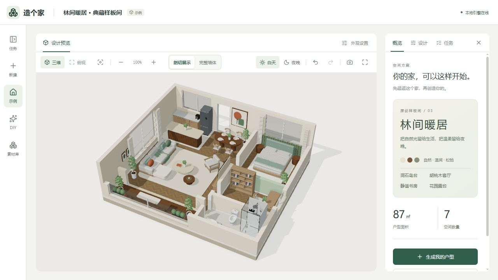
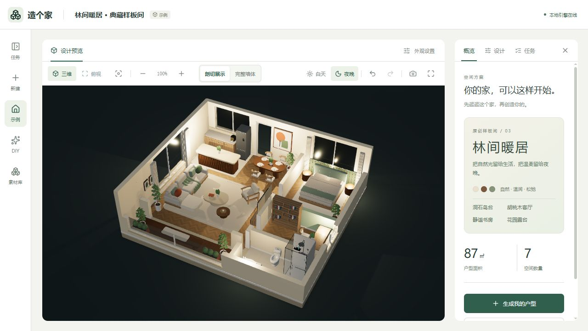
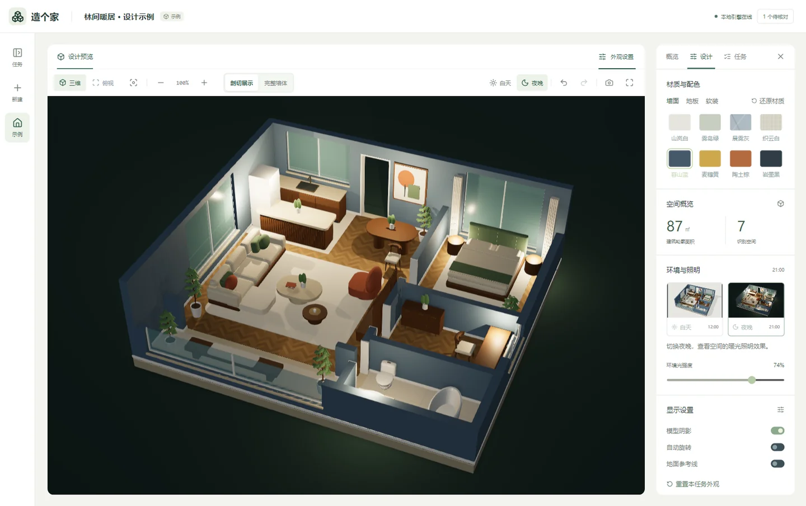

<p align="center">
  
</p>

<p align="center">
  <strong>一张户型图，一次空间想象。</strong><br>
  AI 识别 · 结构核对 · 三维生成 · 自由调整
</p>

<p align="center">
  <a href="#preview">动态演示</a> ·
  <a href="#workspace">工作台</a> ·
  <a href="#quickstart">快速开始</a> ·
  <a href="docs/ai-pipeline-design.md">流程设计</a> ·
  <a href="docs/testing.md">测试说明</a>
</p>

---

基于 React、Three.js 和 FastAPI 构建的开源 AI 户型设计工作台，通过本地 Codex 将二维户型图转化为可交互的 3D 空间，支持结构核对、手动布局、材质与灯光调整及 GLB 导出，无需依赖 Blender。

面向**本地单人使用**：浏览器连接本机服务，任务保存在本机。AI 识别户型，用户确认结构后，程序生成真实 GLB；普通生成无需安装 Blender。

<a id="preview"></a>

## 从平面，到空间

<p align="center">
  
</p>

<p align="center"><sub>林间暖居 · 第三版原创样板间 · 实际 Three.js 页面截图<br>87㎡、七个空间；用户上传户型的结果取决于原图质量与结构核对。</sub></p>

<details>
<summary>查看夜晚效果</summary>



</details>

| 看清空间 | 亲手调整 | 保留成果 |
| :--- | :--- | :--- |
| 三维 / 俯视 / 墙体剖切 | 墙体 / 门窗 / 家具 / 灯位 | GLB 模型 / 结构数据 |
| 白天 / 夜晚 / 材质预览 | 撤销 / 草稿 / 独立版本 | 效果图 / 一致性报告 |

## 功能

- 上传 PNG、JPEG 或 WebP 户型图，最大 20 MB。
- 并排核对原图与识别结构，手动调整墙体、空间、门窗和通道。
- 在确认结构中规划家具，复用 29 类家具资产，生成带材质的 GLB。
- 三维／俯视、完整墙体／剖切、白天／夜晚及材质预览。
- 手动编辑家具、灯位、尺寸、朝向和门窗参数，支持撤销及浏览器草稿。
- 下载模型、结构数据、质量及一致性报告，导出当前效果图。
- 保存历史版本、阶段缓存与检查点；服务重启后继续未完成步骤。

首屏「林间暖居」为项目原创设计示例，与用户上传任务分开。第三版复用内置原创 GLB 家具，补齐壁挂电视、步入式淋浴区、开放书架、餐桌摆盘、针织毯、窗帘和露台种植箱；提供白天自然光与夜晚分区暖光。淋浴区借用卫生间实墙，东侧窗前无实体背板遮挡。模型约 6.3 MB，家具重复实例共享几何，旧版模型保留以兼容已有引用。

人工设计中选中淋浴家具，可切换「独立淋浴房 / 步入式 / 开放式」，保留位置、尺寸与朝向，保存后生成新的三维方案。素材库同时提供三种形式；生成与编辑会检查窗户避让、实墙安装和入口通行条件。

运行 `.venv/Scripts/python.exe scripts/build_showcase.py` 可重建新版 GLB 与前端元数据；构建会检查家具碰撞、门口通行和导出建筑截面。运行 `.venv/Scripts/python.exe -m pytest backend/tests/test_showcase.py -q` 可核验已发布模型的结构、家具落地高度及壁挂电视安装高度。

## 家具 DIY


点击左侧「DIY」入口，描述想要的家具、背景墙、屏风或装饰构件，可选择本地 Codex 模型和推理强度。AI 通过项目内 `diy-contract`、`diy-design` 技能与 LangChain / LangGraph 返回可编辑部件数据，经过校验后生成真实 GLB。

1. 输入如「1.2 米宽的原木玄关柜，绿色双开门、黄铜把手」，点击「AI 生成素材」。也可手动新建。
2. 点选三维部件，调整名称、形状、尺寸、位置、朝向、颜色、粗糙度和金属感；支持增删、复制、撤销及重做。
3. 保存至本地 SQLite 素材库，或继续输入修改要求，让 AI 生成新版本。任务支持取消；失败会显示原因。
4. 在成功任务的「人工设计 → 家具 → DIY 素材库」放入素材，继续移动、旋转、整体缩放，或点击「编辑 DIY 部件」。编辑已放置家具时，默认保留户型中的整体尺寸、位置与朝向；可取消「保留户型中的整体尺寸」来使用新的组合尺寸。最后保存为新的三维方案。

DIY 使用独立页面（`/#diy`），保留工作台导航。支持描述示例、部件搜索、单独查看、正面/侧面/俯视与材质预设。切换工作台页面保留当前 DIY 编辑状态；刷新或关闭浏览器前，未保存设计会提示。

### 素材库（模型与材质）

素材库的「材质与配色」页收录工作台全部 15 款配色，按墙面、地板、软装用途浏览和搜索。地板有 8 款可选，可以直接指定房间应用；「全屋地板」会统一替换所有房间并清除单独配色。

在工作台「外观设置 → 地板 → 地板应用区域」选择具体房间后更换材质，其他房间不会串色。预览设置按任务保存在本机，支持撤销、重做和还原。对已完成任务，点击「在人工设计中保存地板」，检查草稿后保存三维方案；也可以在人工设计的「地板 / 空间」里选择素材。地板配色写入每个房间的 `floor_material` 字段，保存的新 GLB 会保留这些材质，原方案不变。


左侧「素材库」（`/#library`）统一显示 `assets/`、`public/models/` 中的 GLB 文件、已完成的 DIY 素材和有模型文件的成功户型方案。支持来源筛选、名称/文件名搜索、排序、真实三维预览、尺寸/网格/三角面统计和下载；DIY 素材可直接进入部件编辑，户型模型可打开来源方案。

内置库 2.1 提供 27 类原创家具，新增电视机、电视柜、茶几、边几、床头柜、书柜、鞋柜、洗烘一体机、洗碗机、烤箱、休闲单椅与换鞋凳，升级原有家具细节及淋浴间、冰箱。支持真实模型缩略图和 7 类用途筛选。模型与缩略图可随 Git 分发，本地 DIY 和任务副本继续保存在忽略的 `data/` 中。旧方案不会被素材更新覆盖，已放置快照需重新添加才能使用新版。

2.1 新增独立壁挂电视，默认底部离地 1.05 米，自动寻找避开门窗的完整墙面。人工设计的「底部离地高度」支持调整安装高度，电视与下方低柜按垂直区间判断重叠。坐便器重做为连续裙包陶瓷、开孔座圈和抬起盖板；淋浴房重做为黑框玻璃门、瓷板背墙、恒温花洒和置物架。

素材库索引项目内资源，不扫描整台电脑。新文件放入上述资源目录后点击「刷新素材」。预览支持自包含 GLB；引用外部文件的模型会提示重新导出内嵌资源的 GLB。

内置家具和 DIY 素材可选择已完成的目标方案，点击「放入户型并编辑」；人工设计页也有「从 GLB 素材库添加」入口。可设置 10–200% 放置比例，程序优先在当前空间寻找空位，避让现有家具、墙体和门前通道；找不到空位会提示调整。放入后可整体移动、旋转、缩放、复制和删除，保存为新的三维版本。整套户型和示例空间仅供预览，不作为家具放置。

AI 家具规划使用同一素材目录，可选择具体内置 GLB、额外 GLB 和 DIY 素材。GLB 放入时会规范化为底面居中、Y 轴向上的独立副本，保存到 `data/library/<sha256>.glb`；户型通过内容地址引用，重建前检查完整性，不会因源文件替换或移走而变成其他模型。DIY 仍保存完整部件副本。

新增家具 GLB 放到 `assets/` 下即可被扫描和放置，无需修改旧家具类型枚举；GLB 需内嵌资源、使用米制尺寸，单文件不超过 100 MB。当前放置保存静态网格与材质，不保留骨骼动画或可编辑部件；DIY 才支持部件微调。

Git 边界：`assets/furniture/glb/` 等项目资源会随仓库提交；本机 `data/`、SQLite、任务及家具副本被 `.gitignore` 排除。DIY 可以下载 GLB 后放入项目资源目录再提交，但 GLB 本身不包含 DIY 编辑器的部件设计数据，不能据此恢复部件编辑。不要为共享一个素材而提交整个本机数据库。

素材由方体、圆柱和椭球组合，适合柜子、桌椅、背景墙与装饰的参数化设计，不支持任意雕塑网格或复杂曲面生成。单素材最多 48 部件、宽深各不超过 6 米、高不超过 3 米；每户型最多 512 个 DIY 部件。背景墙为独立装饰构件，建筑墙、门窗及通道仍使用人工设计的对应工具。

放入户型的是完整独立副本，素材库后续修改或移出不会改变已保存方案。保存采用版本冲突检查；未保存修改在关闭或切换素材时会提示。AI 只生成数据，不执行 AI 返回的脚本。

<a id="workspace"></a>

## 让空间成为主角

<a href="docs/images/workbench.webp"></a>

<p align="center"><sub>以三维结果为中心，旋转、缩放、剖切与昼夜切换触手可及。</sub></p>

<details>
<summary><strong>再看一眼：夜间照明与材质调整</strong></summary>

<a href="docs/images/materials.webp"></a>

调整材质，切换照明，比较同一个空间的不同氛围。以上均为随项目提供的原创示例。

</details>

---

<a id="quickstart"></a>

## 环境要求

| 依赖 | 说明 |
| --- | --- |
| Node.js | 22+ |
| pnpm | 前端依赖和项目命令，使用 `pnpm-lock.yaml` |
| Python | 3.11+；当前固定依赖在 Windows、Python 3.13.5 下验证 |
| Codex CLI | 使用本机已经安装并登录的版本，账号及模型需支持图片输入 |
| Microsoft Edge | 仅浏览器自动验收需要；日常可用支持 WebGL 的浏览器 |

项目不安装另一份 Codex CLI，不复制登录凭据，也不修改全局模型配置。Blender 仅用于可选的离线家具源工程制作。

## 首次安装与启动

以下命令在 Windows PowerShell 中运行，项目目录可放在 D 盘：

```powershell
git clone git@github.com:Li-Rui-Zhe/LayoutSculpt.git D:\LayoutSculpt
cd D:\LayoutSculpt
pnpm install --frozen-lockfile
python -m venv .venv
.\.venv\Scripts\python.exe -m pip install -r backend/requirements-dev.txt
pnpm build
pnpm start
```

打开 **http://127.0.0.1:8000/**。API 文档：http://127.0.0.1:8000/docs。

`pnpm start` 使用单个 FastAPI 进程同时提供构建页面和 API，只监听本机。修改前端后需重新 `pnpm build`。关闭服务使用 Ctrl+C；不要同时启动多个使用相同数据目录的后端进程。

同为 Windows、Python 3.13.5 的环境，可用 `backend/requirements.lock.txt` 替代范围依赖文件安装，复现已验证的 Python 包版本。其他环境使用 `requirements-dev.txt` 并运行测试。

### 开发模式

```powershell
pnpm dev:all
```

前端 http://127.0.0.1:5173/，后端 http://127.0.0.1:8000/。也可在两个终端分别运行 `pnpm dev` 与 `pnpm dev:api`。开发模式与 `pnpm start` 共用 8000 端口，选择一种后端启动方式。

<details>
<summary><strong>配置本机模型、超时与数据目录</strong></summary>

### 配置

默认继承本机 Codex 登录及模型配置。需要覆盖项目配置时：

```powershell
Copy-Item .env.example .env
```

| 变量 | 默认值／用途 |
| --- | --- |
| `CODEX_CMD` | 可选，指定已经安装的 CLI 路径；默认从 PATH 查找 |
| `CODEX_MODEL` | 可选，项目优先使用的模型，不改全局配置 |
| `CODEX_EFFORT` | `medium`，按实际模型能力适配 |
| `CODEX_TIMEOUT_SECONDS` | `600`，单阶段 AI 总预算，包含修正和重连 |
| `AI_REVIEW_TIMEOUT_SECONDS` | `300`，可选 AI 复核上限，不超过阶段预算 |
| `AI_CACHE_ENABLED` | `true`，复用完全匹配且通过当前校验的阶段结果 |
| `MODEL_TIMEOUT_SECONDS` | `180`，本地模型构建等待上限 |
| `JOB_CONCURRENCY` | `2`，同时处理任务上限 |
| `STUDIO_DATA_DIR` | 项目 `data/`；可指定其他本地数据目录 |

Windows 下，未显式设置 `HTTP_PROXY`、`HTTPS_PROXY` 或 `ALL_PROXY` 时，CLI 子进程继承启用的系统手动代理；不修改系统设置。修改代理后重启项目。

生成页面从本机 CLI 获取模型目录，可手动刷新。模型必须支持图片，实际权限取决于账号及服务商。重试可更换模型和推理强度，创建独立任务；不会静默替换模型。`.env`、登录文件及 API 密钥不得提交仓库。

</details>

## 户型图到三维

```text
上传原图 → AI 结构识别 → 几何校验 → 可选 AI 增量复核
                                        ↓
                        对照原图人工确认／修改结构
                                        ↓
                         AI 家具规划 → 本地摆放检查
                                        ↓
                         确定性 GLB 构建 → 实际模型校验
                                        ↓
                            Three.js 预览与成果下载
```

AI 输出结构化数据，程序据此建模，不执行 AI 返回的任意 Python。确认后的墙体、房间、门窗和轮廓被锁定，家具规划不能改写。导出后重新读取实际 GLB，检查墙体体积、门窗高度区间截面、房间地面及基座轮廓。

<details>
<summary><strong>失败处理、阶段恢复与一致性边界</strong></summary>

### 失败处理与恢复

- 临时 AI 连接错误最多自动重连一次，使用原模型，计入原阶段总预算。
- AI 复核超时或暂时不可用时保留有效识别结构，标记复核未完成，进入人工核对。
- 疑似重复墙、缺少入口等启发式判断仅提醒；无效多边形、失效引用和真实结构不一致仍需修正。
- 自动家具先尝试有限局部平移和缩放；仍放不下的家具暂缓并记录说明。手动摆放不会被自动移动或删减。
- 家具 AI 超时、暂时不可用或响应持续无法读取时，可交付房屋结构，显式标记 `delivery_status=structure_ready` 并提供完善家具入口；完整方案为 `ready`，两者分开统计。
- 后端重启后，处理中任务重新排队，验证原图、参数及确认记录后从检查点继续。待核对任务仍等待用户确认；已取消任务不会自动恢复。
- 历史失败任务可按界面入口重试或恢复有效识别结构，新建版本并保留原记录。

**几何一致性不等于图片识别正确。**缺少尺寸时只能估算，AI 自报置信度不能替代对照原图。产品用于空间方案预览，不替代现场测量或施工图审核。

流程、缓存依据、时间预算与实测方法见 [AI 流程设计](docs/ai-pipeline-design.md)。

</details>

## 工作台操作

- 三维：左键旋转、右键平移、滚轮缩放；触屏支持单指旋转及双指缩放／平移。适配按钮恢复全图。
- 墙体：切换「剖切／完整」，下载的 GLB 保留完整墙高。
- 照明：白天关闭人工灯，夜晚按保存的灯位、亮度、色温及开关照明。隐藏裸灯泡占位造型，保留实际光照。
- 手动布局：点击「手动调整布局」，结构核对阶段也可编辑。新增门窗前选择目标墙，并调整尺寸、位置及门扇／窗台参数。
- 平面编辑：滚轮围绕鼠标缩放，空白拖动或手形模式平移；空格临时平移，`0` 适配全图，方向键微移，Shift 加速。
- 保存手动修改后生成独立版本，原方案保留。网页材质影响当前预览及效果图，模型下载保留生成时材质。

户型外轮廓按墙体和空间边界自动适配，无需单独手工描轮廓。草稿及外观偏好保存在浏览器，清理浏览器数据可能丢失；重要修改应保存为模型版本。

<details>
<summary><strong>开发者入口 · 测试、成功率统计、目录与维护</strong></summary>

## 验证与成功率统计

```powershell
pnpm test:backend
pnpm test:frontend
pnpm build
pnpm test:prelaunch
```

`test:prelaunch` 使用本机 Edge、8011 端口、独立数据与固定 AI 响应，验证真实建模及浏览器交互，不调用实际 AI、不修改用户任务。测试通过不能代表新户型识别成功率。

只读统计本机历史任务，区分完整交付、仅结构交付、失败和待核对：

```powershell
.\.venv\Scripts\python.exe -X utf8 scripts/report_generation_success.py
.\.venv\Scripts\python.exe -X utf8 scripts/report_generation_success.py --replay
```

`--replay` 在隔离目录重建各原图最近成功的保存方案，验证实际 GLB；不调用 AI，不计作新图识别样本。报告写入 `data/success-audits/`。新图首次成功、重试成功与保存方案回放应分别评估。

浏览器视觉检查：

```powershell
pnpm test:visual /api/jobs/<任务ID>/artifacts/model.glb data/visual-review
node scripts/review/verify_workspace.mjs <任务ID>
```

验收范围与方法见 [测试说明](docs/testing.md)，公开仓库的内容范围见 [仓库说明](docs/repository.md)。

## 目录与资产

| 目录 | 内容 |
| --- | --- |
| `frontend/src/` | React 界面、平面编辑器、Three.js 预览 |
| `backend/app/` | API、Codex 适配、LangGraph、SQLite、校验与 GLB 构建 |
| `backend/tests/`、`frontend/tests/` | 隔离测试 |
| `skills/` | 项目 AI 角色契约与提示，随任务保存快照 |
| `assets/furniture/` | 家具索引和必需 GLB；源工程可用制作脚本在本地重建 |
| `public/` | 随项目分发的示例模型、材质和图标 |
| `scripts/` | 启动、资产制作与基准测试；浏览器检查集中在 `scripts/review/` |
| `docs/` | 设计与验收说明 |
| `data/` | 本地任务、原图、数据库、检查点、缓存与报告；不提交 |

家具 GLB 和示例模型随仓库分发，新安装无需先制作资产。替换规范及可选离线制作见 [家具资产库](assets/furniture/README.md)。重建首页示例：

```powershell
.\.venv\Scripts\python.exe scripts/build_showcase.py
```

## 数据与维护

升级前停止服务，备份整个 `data/` 及本机 `.env`；恢复时停止服务并整体还原，保持任务数据库与检查点对应。浏览器未提交草稿需另行保存为模型版本。

仓库包含代码、说明和必要公共资产，不包含用户任务原图、生成成果、数据库、缓存、日志、CLI 安装或本地凭据。若配置项目目录外的数据位置，也应自行备份并排除于 Git。

当前为本地单人产品，尚不提供多人账号隔离、云端调度、完整寻路、精确门扇扫掠或施工安全判断。

</details>

---

## 许可

[Apache License 2.0](LICENSE)。

<p align="center"><sub>造个家 · LayoutSculpt<br>从一张平面图，到一个理想的家。</sub></p>
