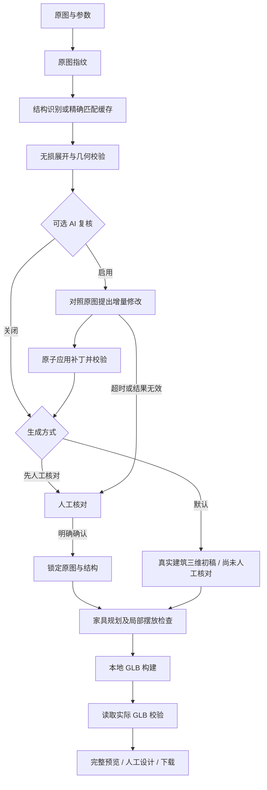

# 户型图到三维的流程设计

适用场景：本地单人，浏览器连接本机服务。AI 来源在接入页选择本机 Codex 或 DeepSeek API；户型识别需要具备图片能力的模型，不能把文字模型当作视觉模型。两条接入方式共用结构约束、复核、家具规划、模型构建和恢复逻辑。生成 GLB 无需 Blender。

## 职责分工

AI 负责理解图片和提出家具布局；程序负责数据约束、几何构建与实际模型校验。用户负责核对图像理解中的歧义。

## 结构识别

采用紧凑数据传输，减少重复字段；坐标用 `[x,y]`，内部仍展开为标准 Layout。保留坐标精度、厚度、高度、开口范围、门扇方向、空间材质和证据灯位，不简化轮廓或强制轴对齐。

使用 Pydantic 和几何检查约束输出。无效多边形、开口越界及失效引用需要修正；疑似重复墙、入口遗漏等启发式判断作为核对提醒，不自动改写原图结构。

无尺寸标注时保存估算依据。AI 自报置信度仅供参考，不能作为图片理解正确性的证明。

## 增量复核

独立角色对照原图检查轮廓、比例、房间、墙体、开口和通行。只输出有依据的增删改补丁，带原结构版本及对象 ID。

补丁在副本中一次性应用并完整校验；未知 ID、错误版本或无效结果不会产生部分修改。未提及的对象保留。复核超时、临时不可用或修正后仍无效时，保留有效候选并标记复核未完成，进入人工核对。

## 确认与一致性

默认流程先展示建筑初稿，人工确认是独立状态。初稿与最终模型均可为 `source_reviewed=false`；通过机器校验、AI 复核或达到某个置信度都不能改成已人工核对。只有明确点击确认，才保存原图摘要、结构摘要、确认时间及 `method=user_review`。家具规划不能改写墙体、门窗、房间和外轮廓。

结构摘要统一等价数字写法，例如 `90` 与 `90.0`，不四舍五入真实坐标。兼容旧确认记录时必须与原始快照核对数值等价，不能任意忽略摘要不一致。

建模前后检查来源与确认结构；导出后重新读取实际 GLB，检查实体闭合、墙体体积、门窗高度区间截面、房间地面和建筑基座。浮点容差用于容纳 GLB 精度误差，不允许真实结构漂移。

这些检查验证模型与结构数据一致；结构是否正确表达原图，仍需核对图纸。

## 渐进展示

`prepare_review` 完成来源和结构校验后，按任务的 `review_mode` 分流。新前端明确提交 `preview`；旧任务和未指定字段的 API 请求默认 `manual`。恢复未完成复核的结构仍进入人工核对。

初稿使用正式 GLB 建模器及实际建筑材质，包含墙体、地板和门窗，不放置简化家具占位盒。先在 `initial-pending/` 完成构建，成功后发布到 `initial/`，通过单独的只读端点提供预览。发布后才继续家具规划，最终成果使用任务根目录下的正式文件。

生成中的初稿可以查看和旋转，但不能直接人工编辑或作为正式成果下载；正式成果完成后开放人工设计。这样避免后台完成时覆盖用户修改。自定义风格的最终搭配在家具规划后补齐。多一次本地建筑构建改善等待体验，不保证完整方案更早完成。

## 家具与交付

家具规划与结构职责分离，使用可复用 GLB 资产及参数化构件，不执行 AI 返回的任意代码。

自动方案检查房间归属、占地、实体墙碰撞、家具重叠与门口通行。必要时局部平移不超过 0.25 米、缩小不超过 10%；仍无法放置的单件家具暂缓并记录说明。手动方案不会被自动移动或删减。

家具阶段超时、临时不可用或结构化响应持续无效时，允许明确交付房屋结构：

| 状态 | 含义 |
| --- | --- |
| `ready` | 家具规划阶段完成并交付模型；局部调整见质量报告 |
| `structure_ready` | 房屋结构已交付，家具规划未完成，可直接继续布置家具 |
| `awaiting_review` | 等待用户确认，不生成最终模型 |
| `failed` | 本次未完成交付，保留原图、可用初稿与有效中间步骤 |

结构损坏、真实来源变化、确认结构不匹配或实际模型几何不一致仍阻止交付。仅结构交付不能计作完整家具方案成功。

“继续布置家具”基于已保存方案创建独立版本，不覆盖原版本和人工草稿。若希望以手动修改作为新规划基础，应先保存该设计版本。

## 时间预算与恢复

单阶段预算默认 600 秒，包含启动、排队、一次校验修正和结果返回。可选复核另有默认 300 秒上限，不超过阶段预算。

临时 AI 连接错误最多重连一次，使用原模型并计入阶段预算；不支持的模型和授权错误不盲目重复。文件处理与进程清理可能产生额外开销，这些配置不是远端响应保证。

LangGraph 保存图状态，SQLite 保存任务及事件。服务重启时将运行中或排队的任务重新排队，验证任务 ID、原图、参数与确认记录后从待执行节点继续。处于 `awaiting_review` 的任务继续等待用户；已取消或其他终态任务不自动执行。

失败或取消后，默认操作是同任务“继续生成”，不重新选模型。SQLite 事务比较用户看到的任务更新时间，只重开该次终态；重复点击不会启动两个 worker，旧请求不能再次重开下一轮失败。恢复前等待上一轮 worker 退出，前端重新订阅进度，不被历史失败事件提前关闭。

没有检查点时从原输入重跑，仍可利用有效阶段缓存；检查点与输入不一致时拒绝盲目复用。更换模型重新生成仍是独立新版本，不把不同参数混进旧检查点。登录失效或额度不足提供 AI 接入入口，不自动换服务商。

| 接口 | 用途 |
| --- | --- |
| `POST /api/jobs`，`review_mode=preview\|manual` | 创建任务并选择默认预览或先人工核对 |
| `POST /api/jobs/{id}/continue`，JSON `revision` | 沿用原参数继续失败/取消的任务，revision 为任务的 updated_at |
| `POST /api/jobs/{id}/retry` | 以原图和所选参数创建独立重试版本 |
| `GET /api/jobs/{id}/preview/model.glb` | 读取已发布的生成初稿，仅供查看 |

人工设计的 `POST /api/jobs/{id}/preview` 为另一条热更新接口，不与生成初稿混用。

## 阶段缓存

缓存键包含原图 SHA-256、任务输入、项目技能、输出 schema、流程版本、模型、强度和本地环境指纹。环境指纹包含服务商、账号指纹及 CLI 版本信息，不保存登录凭据。

仅缓存完整且通过校验的结果。读取时验证内容摘要并执行当前规则，损坏缓存按未命中处理。缓存不继承人工确认；主动重新规划或复核绕过相应缓存。

## 指标与验证

每个任务保存 `pipeline-metrics.json`，记录阶段、模型、强度、尝试次数、连接重试、缓存命中、输入／输出字符数及耗时。字符数不是 token 数，不用于推算固定速度提升。

成功率按不同原图、策略版本和交付类型统计。已保存方案回放验证确定性建模，不能代替新图识别测试。实际命令及验收范围见 [测试说明](testing.md)。
