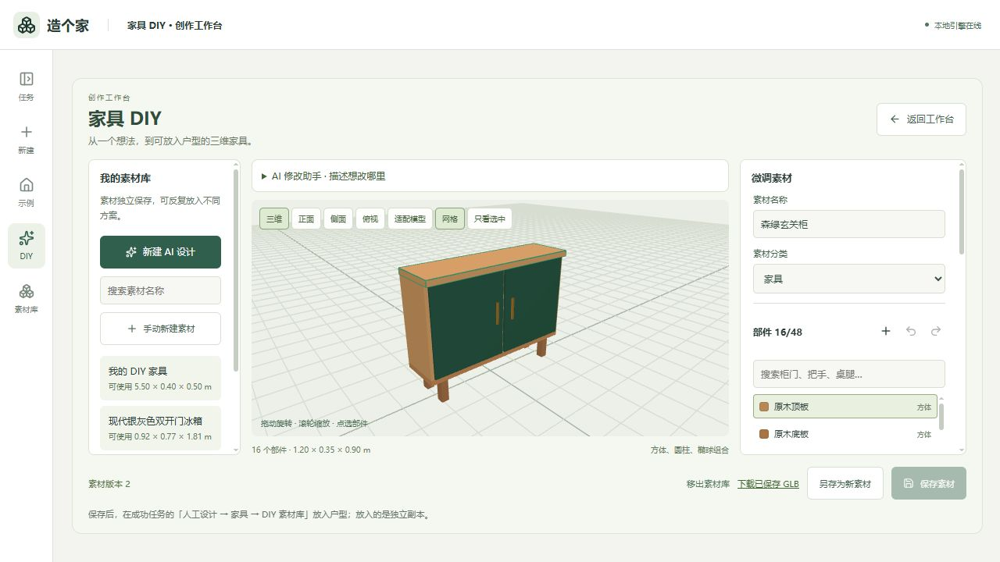
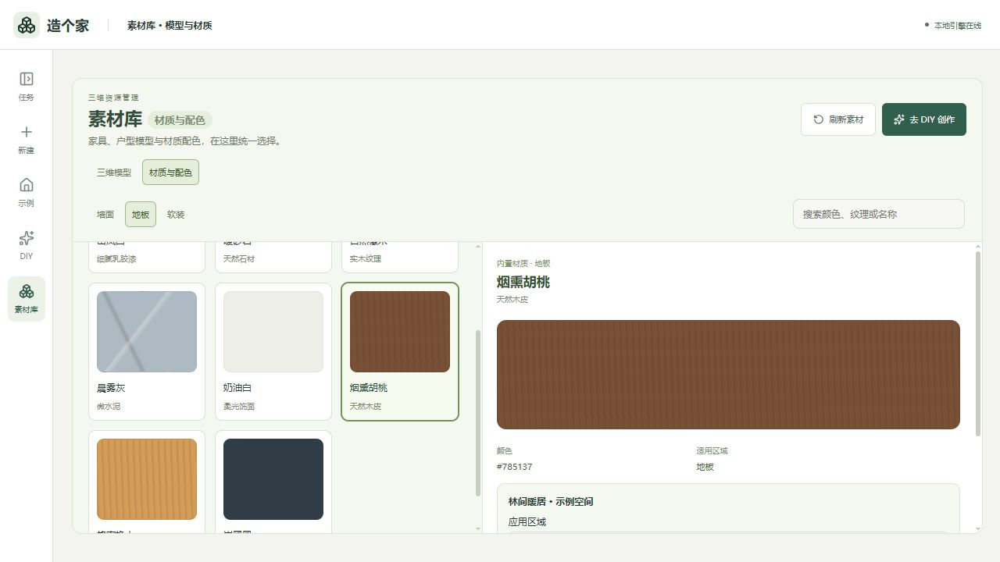
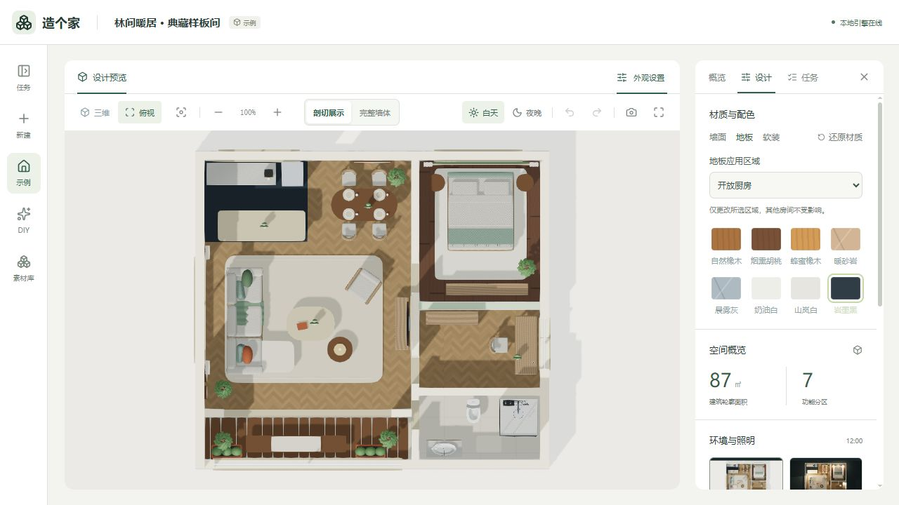
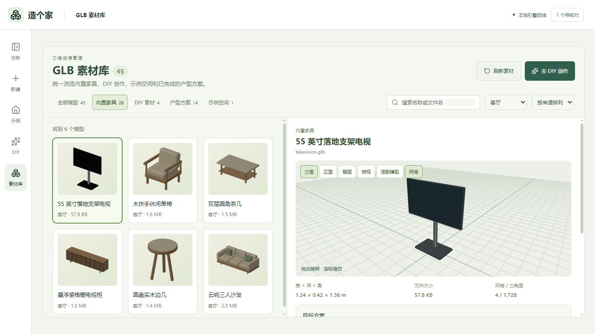

# 设计工作流与素材使用

本文保留工作台、家具 DIY、素材库与模型共享的详细用法。产品演示和安装入口见 [README](../README.md)。

AI 来源在「AI 接入」中选择本机 Codex 或 DeepSeek API，两种接入方式共用设计与校验流程。户型及参考图识别需要视觉模型；无参考图的家具和材质创作可使用文字模型。直接 API 目前接入 DeepSeek，不要求所有能力都经过 Codex。

## 从上传到设计

1. 上传户型图，选择风格并填写设计要求。模型、强度、精细家具与 AI 复核使用默认设置，需要时展开高级设置。
2. 默认先展示真实建筑三维初稿，再补齐家具。初稿可旋转、缩放和对照原图，明确标注“尚未人工核对”；完成前只供查看，避免后台覆盖编辑。
3. 生成完成后，进入平面或三维人工设计。两页使用同一份草稿，保存后建立独立成果版本。
4. 失败或取消后点击“继续生成”，沿用原设置，复用有效步骤；更换模型通过次级入口创建新版本。登录或额度问题先进入 AI 接入处理。

高级设置可选择先人工核对；AI 复核未完成时也会停在核对页。点击“已核对，继续生成”才记录人工确认。机器几何校验通过不会自动变成人工核对通过。

## 原创样板间与结构验证

首屏「林间光庭」为项目原创设计示例，与用户上传任务分开。样板间为 93.2㎡、七个功能分区，采用通透花园露台、胡桃木、洞石、亚麻和古铜细节。露台采用有落地支腿与靠背的柚木双人沙发、休闲椅、薄边洞石茶桌和香草花箱，保留约 80 厘米通行路线；移除原无靠背长凳和静水石钵。主卧改为实墙床头、侧窗采光，客厅脚凳补齐木框支撑，厨房增加嵌入灶台，冰箱保留独立外观。晴天按窗向布光，日落与夜晚可直接切换。家具重复实例共享几何，橄榄树按六个部件合并复用；当前 GLB 约 11.9 MiB，发布检查上限为 12 MiB。模型 URL 兼容原引用，通过内容 revision 更新缓存。主卧东侧窗帘随墙体剖切至 1.2 米，上方轨道及挂扣同步隐藏；完整墙体模式恢复整幅窗帘，保留全高西墙的客厅窗帘不受影响。

示例的模型与基础布局均随代码发布。复制示例可开始独立设计；户外座椅、茶桌、织物、植栽等部分展示陈设属于样板专用几何，尚非全部可编辑对象，人工设计重新建模以可编辑布局为准。环境展示用于观感预览，不代表真实采光分析。

人工设计中选中淋浴家具，可切换「独立淋浴房 / 步入式 / 开放式」，保留位置、尺寸与朝向，保存后生成新的三维方案。素材库同时提供三种形式；生成与编辑会检查窗户避让、实墙安装和入口通行条件。

人工设计中的淋浴通行、尺寸、靠墙和窗户避让检查属于布局建议：保留提示与定位，允许继续保存和生成三维，不自动改动家具。入口检查按家具矩形占地估算正面 0.55 米预留区，边角重叠不能单独作为禁止保存的依据。无效数据、空间重叠、家具超出所属房间等基础错误仍会阻止保存；AI 自动布置及素材自动找位保留原有严格检查。

运行 `.venv/Scripts/python.exe scripts/build_showcase.py` 可重建新版 GLB 与前端元数据；构建会检查家具碰撞、门口通行和导出建筑截面。运行 `.venv/Scripts/python.exe -m pytest backend/tests/test_showcase.py backend/tests/test_showcase_textiles.py backend/tests/test_showcase_garden.py -q` 可核验实际交付模型的结构、家具落地、软包支撑、露台通道及卧室窗位。`scripts/review/verify_showcase.mjs` 检查三种环境、墙体切换和移动端，并保存露台、客厅、主卧近景。

## 灯具素材与添加

「素材库 → 灯具」提供亚麻阅读落地灯、陶瓷床头台灯、乳白玻璃吊灯、薄边吸顶灯、防眩筒灯和磨砂灯泡。卡片缩略图来自实际 GLB，右侧可旋转预览。人工设计「灯具 → 添加 → 从灯具素材库选择」使用同一入口。

选择可编辑方案后，点击「在平面中放置」或「在三维中放置」，移动鼠标查看落点，点击确认；Esc 取消且不写入草稿。原来的「添加灯具」按钮也进入落点选择，不再直接放到户型中心。放好后可拖动、修改光源高度、流明、色温、灯组及开关，支持撤销和保存。台灯需按实际台面精调高度，当前不自动寻找或吸附桌面；每个方案最多 12 盏灯。

落地灯和台灯显示实际外形；为避免遮挡空间，灯泡及吊灯的外形在设计预览中默认隐藏，光照仍保留，可从对象列表选择调整。素材库始终显示六款完整模型。保存后在设计预览切换夜晚检查照明效果。灯罩对自身光源使用柔化阴影处理，保留墙体遮挡。

`backend/app/fixture_models.py` 是模型的共同来源，生成任务、编辑预览及示例阅读落地灯共用建模函数。`python scripts/build_lighting_library.py` 更新库内 GLB 和前端目录，`node scripts/review/build_lighting_thumbnails.mjs` 从模型生成缩略图（默认本项目 5176，可配置 `STUDIO_BASE_URL`）。旧成果文件不会被自动改写，需要在人工设计中保存生成新版本才更新灯具模型。

## 家具 DIY

点击左侧「DIY」入口，描述想要的家具、背景墙、屏风或装饰构件，可选择已接入的 Codex 或 DeepSeek 模型，按模型能力调整推理强度。AI 通过项目内 `diy-contract`、`diy-design` 技能与 LangChain / LangGraph 返回可编辑部件数据，经过校验后生成真实 GLB。

1. 输入如「1.2 米宽的原木玄关柜，绿色双开门、黄铜把手」，点击「AI 生成素材」。也可手动新建。
2. 点选三维部件，调整名称、形状、尺寸、位置、朝向、颜色、粗糙度和金属感；支持增删、复制、撤销及重做。
3. 保存至本地 SQLite 素材库，或继续输入修改要求，让 AI 生成新版本。任务支持取消；失败会显示原因。
4. 在成功任务的「人工设计 → 家具 → DIY 素材库」放入素材，继续移动、旋转、整体缩放，或点击「编辑 DIY 部件」。编辑已放置家具时，默认保留户型中的整体尺寸、位置与朝向；可取消「保留户型中的整体尺寸」来使用新的组合尺寸。最后保存为新的三维方案。

DIY 使用独立页面（`/#diy`），保留工作台导航。支持描述示例、部件搜索、单独查看、正面/侧面/俯视与材质预设。切换工作台页面保留当前 DIY 编辑状态；刷新或关闭浏览器前，未保存设计会提示。

### 素材库（模型、材质与建筑构件）

「建筑构件」按墙体、门、窗、通道及阳台围护分为五类，共 17 个住宅构件样板。可旋转预览，调整高度、厚度、宽度、窗台、开口位置及门扇开向；围护按原墙段长度适配，门窗和通道按真实开口安装，也可明确选择替换已有开口。应用后进入人工设计草稿，可撤销，保存生成后更新正式模型。

双开门、玻璃移门、平开窗、推拉窗与磨砂窗会保留各自样式。安装前检查高度、边界、重叠与锁定状态；玻璃栏板不能直接安装门窗。对已有方案仅修改指定墙段或开口，其他建筑及家具保留。详情见 [建筑构件与阳台围护](balcony-boundaries.md)。

素材库按墙面、地板等用途浏览和搜索装修材质，家具 DIY 使用独立的家具饰面。当前内置墙面、地板各有 10 款，另可添加自制材质；地板，可以直接指定房间应用；「全屋地板」会统一替换所有房间并清除单独配色。

在工作台「外观设置 → 地板 → 地板应用区域」选择具体房间后更换材质，其他房间不会串色。预览设置按任务保存在本机，支持撤销、重做和还原。对已完成任务，点击「在人工设计中保存地板」，检查草稿后保存三维方案；也可以在人工设计的「地板 / 空间」里选择素材。地板配色写入每个房间的 `floor_material` 字段，保存的新 GLB 会保留这些材质，原方案不变。

人工设计右侧的「地板应用房间」可直接切换房间，三维用绿色轮廓标示当前空间；地板工具下点击模型优先选取地板。更换地板材质或铺贴参数时保留当前画面，新模型载入后再替换，避免临时预览将全屋套用同一材质。同步浮层按准备、建模、接收、载入几个阶段显示预计百分比，只有模型实际就绪才显示 100%；浮层不改变画布尺寸和镜头。

编辑器将平面 / 三维切换与六类对象工具合并在同一工具栏。建筑构件不再单独放在顶部：在「墙体 / 门窗 / 通道 → 添加」中选款式，直接在当前平面或三维画布放置；阳台围护归入墙体。选中现有墙体或开口后，右侧「构件款式」可直接更换，门窗保留原位置和洞口尺寸，非法尺寸或重叠会被拦截，支持撤销。独立素材库仍用于完整浏览预览。

地板房间选择与锁定收进属性栏标题区，常用材质显示四款，可展开全部；铺贴、空间边界、墙体校准、门扇等参数按需展开，AI 局部复核位于属性栏底部。素材库顶部提供三维模型、装修材质和建筑构件入口，素材列表与三维预览分别滚动；墙面材质详情以立体墙段展示。

三维设计中，已加载的单开木门、双开门和玻璃平开门，修改开启角度、开启方向或铰链位置时直接变换现有门扇网格，保留材质、把手与剖切上下半段，不重新请求整屋预览，也不显示建模进度。尺寸、安装墙段和款式变化仍按结构更新；无法可靠绑定的旧模型保留原建模流程。保存时按当前草稿生成正式模型，支持撤销与重做。

家具的位置、旋转、离地高度及显示状态，灯具的亮度、色温及开关也在已加载模型上更新。带完整部件归属标记的灯具支持直接平移，灯罩、灯杆、光源、照射目标和点选区域同步移动，不触发整屋临时结构重建或等待提示；旧模型无法完整绑定时仍回退正式建模。拖动输入每帧合并一次，松手提交最后落点，取消清理待执行更新；选框复用几何与材质。名称、说明、锁定等非视觉信息只更新草稿，不触发三维重建或临时结构覆盖。各灯具使用独立的发光材质，避免开关与色温互相影响。家具尺寸、款式、材质、灯具发光点高度以及墙体和洞口变化仍可能需要正式建模：高度可能改变灯杆或吊线形状，不能简单移动或拉伸代替正式导出。

平移保留未改轴、家具尺寸与角度的原始精度。预览身份和对象等待提示统一忽略小数点后 9 位以外的浮点尾差，例如生成结果中的 `2.4499999999999997` 与旧草稿中的 `2.45`；保存数据不被改写，毫米级高度变化仍需正式建模。多个控件及 effect 的绘制请求每帧合并一次，首次模型就绪仍先立即绘制再结束加载状态。全屋检查缓存已提交快照，松手时继续校验候选结果，避免拖动每一帧都重新检查全屋。

`node scripts/review/verify_generated_drag.mjs <本地项目 ID>` 只读载入真实生成成果和旧草稿，通过隔离任务拦截全部写请求，验证实际灯具连续拖动、撤销、取消、刷新和保存；同时断言没有整屋预览请求、临时结构覆盖或加载标签。可用 `STUDIO_BASE_URL=http://127.0.0.1:8000` 验收构建后的正式页面。

刷新或返回三维设计时，若草稿只包含可本地表达的变动，先载入已有 GLB，再根据实际绑定能力同步；模型缺少必要网格时回退建模。进行中的相同预览请求去重，旧请求完成不能覆盖新设计，失败后仍可重试。推拉门当前只展示固定轨道造型，不显示无效的旋转角度控件；双开门不显示单侧铰链选项。

### 上传原图与示例

新建页上传区提供清晰完整、严重模糊、结构截断和非户型图四项示意对照。示例仅用于说明上传要求，不代表系统已检查当前图片。

识别阶段在同一次读图中返回 `input_check`，不额外安排一次默认 AI 调用。明确非户型图、主要墙线严重模糊、关键结构被截断或整体不可辨认时，任务停止在建模之前，展示原图、具体依据与「更换图片」。换图会带入风格、设计要求、材质与生成设置，原任务保留；不能通过「继续生成」绕过检查。

手绘、黑白、拍照、缺尺寸和局部文字不清，只要主要结构可辨认就继续；估算与局部疑问写入识别说明，不使用 AI 自报置信度阈值拒绝，也不生成补图猜测缺失墙体。检查属于模型判断，可能误判，不等于结构正确性或人工确认；缺失或矛盾的检查结果不能直接通过。旧任务的已有成果不因此被重做。

左侧「素材库」（`/#library`）统一显示 `assets/`、`public/models/` 中的 GLB 文件、已完成的 DIY 素材和有模型文件的成功户型方案。支持来源筛选、名称/文件名搜索、排序、真实三维预览、尺寸/网格/三角面统计和下载；DIY 素材可直接进入部件编辑，户型模型可打开来源方案。

当前内置库 3.2.0 提供 **83 款家具、45 个品类、10 个主空间分类**，覆盖客厅、卧室、儿童房、餐厅、书房、玄关、厨房、卫浴、阳台与装饰；包括台式电脑、笔记本电脑及多种晾衣架。支持空间、品类、风格、尺寸与关键词组合筛选。卡片分批显示，搜索仍覆盖完整索引。款数以 `assets/furniture/catalog.json` 为准；上方旧截图仅演示操作。

模型与缩略图可随 Git 分发，本地 DIY 和任务副本保存在忽略的 `data/` 中。旧方案不会被素材更新覆盖，已放置快照需重新添加才能使用新版。

独立壁挂电视，默认底部离地 1.05 米，自动寻找避开门窗的完整墙面。人工设计的「底部离地高度」支持调整安装高度，电视与下方低柜按垂直区间判断重叠。坐便器重做为连续裙包陶瓷、开孔座圈和抬起盖板；淋浴房重做为黑框玻璃门、瓷板背墙、恒温花洒和置物架。

素材库索引项目内资源，不扫描整台电脑。新文件放入上述资源目录后点击「刷新素材」。预览支持自包含 GLB；引用外部文件的模型会提示重新导出内嵌资源的 GLB。

内置家具和 DIY 素材可选择已完成的目标方案，点击「放入户型并编辑」；人工设计页也有「从 GLB 素材库添加」入口。可设置 10–200% 放置比例，程序优先在当前空间寻找空位，避让现有家具、墙体和门前通道；找不到空位会提示调整。放入后可整体移动、旋转、缩放、复制和删除，保存为新的三维版本。整套户型和示例空间仅供预览，不作为家具放置。

AI 家具规划使用同一素材目录，可选择具体内置 GLB、额外 GLB 和 DIY 素材。GLB 放入时会规范化为底面居中、Y 轴向上的独立副本，保存到 `data/library/<sha256>.glb`；户型通过内容地址引用，重建前检查完整性，不会因源文件替换或移走而变成其他模型。DIY 仍保存完整部件副本。

新增家具 GLB 放到 `assets/` 下即可被扫描和放置，无需修改旧家具类型枚举；GLB 需内嵌资源、使用米制尺寸，单文件不超过 100 MB。当前放置保存静态网格与材质，不保留骨骼动画或可编辑部件；DIY 才支持部件微调。

Git 边界：`assets/furniture/glb/` 等项目资源会随仓库提交；本机 `data/`、SQLite、任务及家具副本被 `.gitignore` 排除。DIY 可以下载 GLB 后放入项目资源目录再提交，但 GLB 本身不包含 DIY 编辑器的部件设计数据，不能据此恢复部件编辑。不要为共享一个素材而提交整个本机数据库。

素材由方体、圆柱和椭球组合，适合柜子、桌椅、背景墙与装饰的参数化设计，不支持任意雕塑网格或复杂曲面生成。单素材最多 48 部件、宽深各不超过 6 米、高不超过 3 米；每户型最多 512 个 DIY 部件。背景墙为独立装饰构件，建筑墙、门窗及通道仍使用人工设计的对应工具。

放入户型的是完整独立副本，素材库后续修改或移出不会改变已保存方案。保存采用版本冲突检查；未保存修改在关闭或切换素材时会提示。AI 只生成数据，不执行 AI 返回的脚本。
